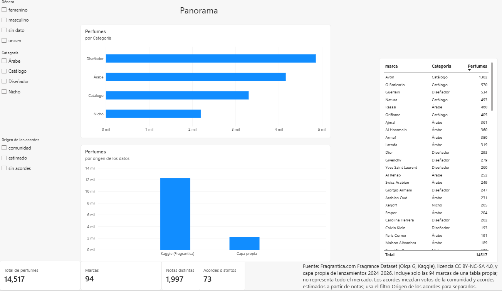
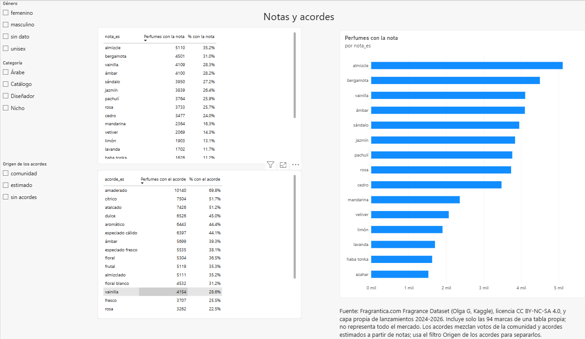
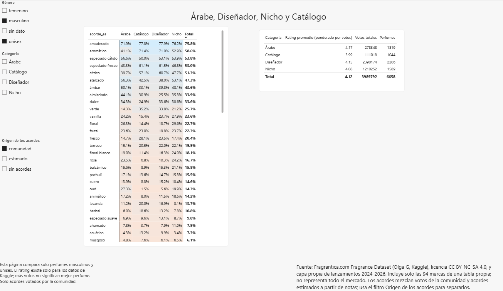
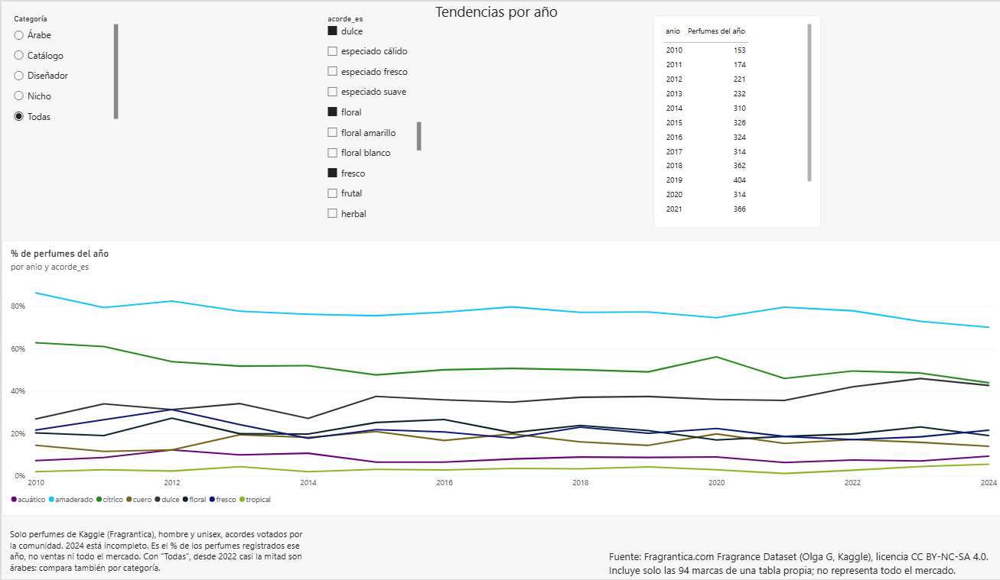
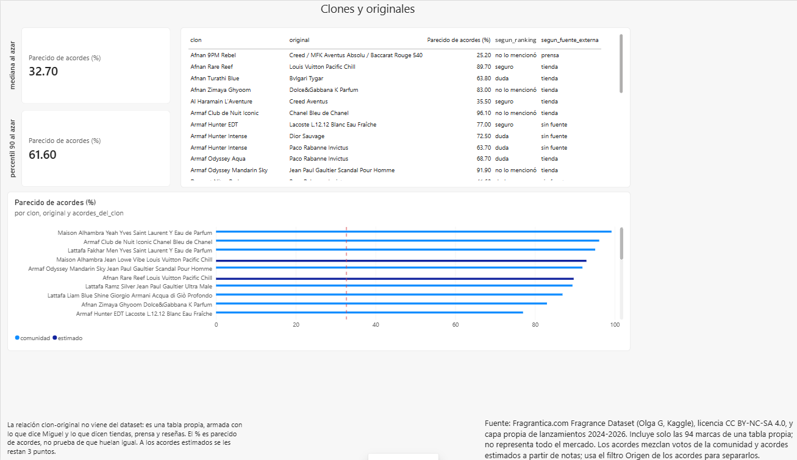
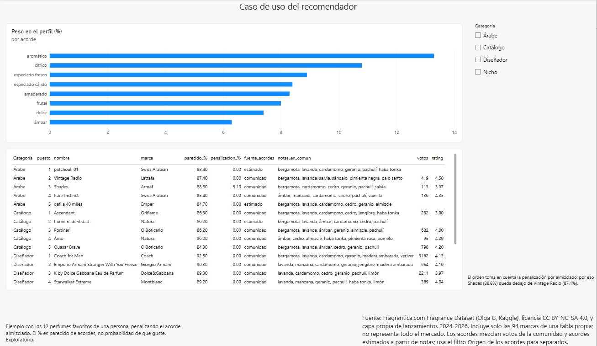

# ¿Árabe, diseñador o nicho? Lo que separa a 72 mil perfumes

Análisis de datos de **72,172 perfumes** para comparar casas árabes, de diseñador, nicho y catálogo, ver cómo han cambiado los acordes con los años y medir qué tanto se parecen los clones a sus originales. Incluye un **recomendador por similitud de acordes** y un **tablero en Power BI**.

**Pruébalo en línea:** [Huella Olfativa](https://huella-olfativa.streamlit.app), recomendador de perfumes por similitud de acordes.

**Resultado en una línea:** los árabes no son más dulces que los de diseñador (34 % vs 34 %); se distinguen porque llevan mucho menos acorde aromático (41 % vs 71 %) y más almizclado y atalcado.

> **En 30 segundos (para reclutadores)**
> - **Problema:** ¿qué distingue a cada tipo de casa perfumera, qué cambió de 2010 a 2024 y qué tan fieles son los clones?
> - **Datos:** 69,948 perfumes de Fragrantica (Kaggle) + 2,224 lanzamientos 2024–2026 recopilados a mano de 94 marcas.
> - **Método:** limpieza y unificación de notas, emparejamiento difuso de nombres, SQL en DuckDB, regresión ridge para estimar acordes (86 % de parecido en prueba) y similitud coseno.
> - **Herramientas:** Python (pandas, scikit-learn), SQL con DuckDB y Power BI.
> - **Resultado:** 5 hallazgos con datos de la comunidad, un recomendador funcional y un tablero de 6 páginas.
> - **Producto:** página web en línea, *Huella Olfativa* (Streamlit): recomendador con modo para principiantes.



## Página: Huella Olfativa

[huella-olfativa.streamlit.app](https://huella-olfativa.streamlit.app) · *Adondequiera que vayas, deja tu huella.*

| Función | Qué hace |
|---|---|
| Descubre tu huella | Eliges perfumes, aromas o notas; tu huella se dibuja en vivo y te recomienda perfumes de diseñador, árabes, nicho y catálogo |
| No sé nada de perfumes | 5 preguntas de la vida diaria (olores, ocasión, intensidad, perfumes conocidos) que se traducen a acordes |
| Parecidos a un perfume | Eliges uno y muestra los más parecidos, aunque no sean clones |
| Clones vs originales | Qué tan parecido es cada clon a su original, según la tabla propia |
| Ver cálculo | Muestra la huella en números y qué acordes aportan más a cada recomendación |

Se busca entre 70,679 perfumes; se recomienda entre ~9,800 (94 marcas clasificadas, con 50 votos o más o con acordes estimados de confianza). El % es parecido de acordes, no probabilidad de que te guste. Versión gratuita y no comercial, por la licencia del dataset.

## Tablero en Power BI

| Página | Qué responde |
|---|---|
| 1. Panorama | ¿Cuántos perfumes, marcas y votos hay por categoría? |
| 2. Notas y acordes | ¿Qué notas y acordes son los más comunes? |
| 3. Categorías | ¿En qué acordes se diferencian árabe, diseñador, nicho y catálogo? |
| 4. Tendencias | ¿Cómo cambiaron los acordes de 2010 a 2024? |
| 5. Clones | ¿Qué tanto se parece cada clon a su original? |
| 6. Recomendador | Con un perfil real, ¿qué perfumes recomienda el modelo? |

| | |
|---|---|
|  |  |
|  |  |
|  | |

## Qué se evaluó

| Fuente | Qué aporta | Perfumes |
|---|---|---|
| Fragrantica.com Fragrance Dataset (Olga G, Kaggle), **CC BY-NC-SA 4.0** | Notas, acordes votados, calificación, votos, año y género | 69,948 |
| Capa propia | Lanzamientos masculinos y unisex 2024–2026 de 94 marcas (sitios oficiales, tiendas y prensa) | 2,224 |
| Tablas propias | Marca → categoría, equivalencias clon–original y un ranking personal de 37 perfumes | — |

**Reglas:**

- Las comparaciones usan perfumes masculinos y unisex y acordes votados por la comunidad, salvo que se diga otra cosa.
- Los porcentajes dicen cuántos perfumes registrados llevan un acorde; no miden ventas ni calidad.
- Los acordes de la capa propia son **estimados** a partir de sus notas y van marcados como tales.
- La relación clon–original no viene del dataset: es una tabla propia, documentada con tiendas, prensa y reseñas.
- El porcentaje del recomendador es parecido de acordes, no probabilidad de que te guste.

## Resultados

### 1. Los árabes se distinguen más por lo que les falta que por lo dulce

| Acorde | Árabe (1,819) | Diseñador (2,206) |
|---|---|---|
| Aromático | 41 % | 71 % |
| Almizclado | 44 % | 25 % |
| Atalcado | 56 % | 38 % |
| Dulce | 34 % | 34 % |

### 2. La calificación no separa categorías

El promedio ponderado por votos va de **3.99** (catálogo) a **4.17** (árabe), con 111 mil a 2.39 millones de votos según la categoría. Más votos no significan mejor perfume.

### 3. Lo dulce subió en el nicho, no en el diseñador

| Categoría | 2015 | 2023 |
|---|---|---|
| Nicho | 33 % (111 perfumes) | 52 % (101) |
| Diseñador | 40 % (132) | 41 % (98) |

Desde 2022 casi la mitad de los perfumes registrados son árabes, así que se compara por categoría para no confundir el cambio de mezcla con una tendencia.

### 4. No todos los clones famosos se parecen a su original

Dos perfumes al azar se parecen **32.7 %** (mediana).

| Clon | Original | Parecido de acordes |
|---|---|---|
| Maison Alhambra Yeah | YSL Y EDP | 99.2 % |
| Armaf Club de Nuit Iconic | Bleu de Chanel | 96.1 % |
| Al Haramain L'Aventure | Creed Aventus | 35.5 % |
| Rasasi Hawas | Paco Rabanne Invictus | 34.8 % |

El parecido de acordes no prueba que dos perfumes huelan igual.

### 5. Caso personal (exploratorio)

En un ranking personal de 37 perfumes, entre los 25 que el autor usa todo el año, el acorde almizclado aparece en **0 de sus 8 favoritos** y en **7 de los 8 que menos le gustan**. Al revolver el ranking 20,000 veces, algo así salió por azar 4 de cada 10,000 veces. Su ranking no se relaciona con la calificación de la comunidad (rho = −0.14, n = 25). Describe el gusto de una persona: no prueba causa ni se generaliza.

## Conclusiones

1. La idea de que "los árabes son puro dulce" no se sostiene: la diferencia está en menos aromático y más almizclado y atalcado.
2. La calificación de la comunidad es casi igual entre categorías; no sirve para elegir tipo de casa.
3. El aumento de lo dulce viene del nicho, no del diseñador.
4. Que un perfume se venda como clon no garantiza que se parezca en acordes: algunos rondan el 99 %, otros quedan cerca del azar.
5. Un recomendador por acordes permite ir del perfil de una persona a opciones concretas en cada categoría.

## Limitaciones

- **Cobertura:** el tablero cubre solo las 94 marcas de la tabla propia, no todo el mercado.
- **Fechas:** Kaggle llega a septiembre de 2024; lo posterior viene de la capa propia, con acordes estimados y años a veces aproximados.
- **Sesgo de la capa propia:** solo masculinos y unisex, y 69 % árabe.
- **Sin notas:** 52 perfumes de la capa propia no tienen notas y no entran al recomendador.
- **Parecido no es gusto:** el porcentaje del recomendador mide acordes, no probabilidad de que te guste.

## Cómo reproducir

1. Descarga el dataset de Kaggle y coloca `fra_perfumes.csv` y `fra_cleaned.csv` en `data/raw/` (no se incluye en el repositorio).
2. Copia los archivos de `data/propios/` a `data/processed/`.
3. Instala dependencias y corre todo:

```bash
pip install -r requirements.txt
python src/correr_todo.py
```

`01_emparejar_ranking.py` documenta el emparejamiento original del ranking; las correcciones manuales están en `data/propios/ranking_emparejado.csv`.

Para correr la página: `pip install -r app/requirements.txt` y `streamlit run app/app.py`.

## Estructura

```
analisis-perfumes/
├── src/
│   ├── 01_emparejar_ranking.py      # ranking personal ↔ dataset (difuso + manual)
│   ├── 02_construir_duckdb.py       # carga todo en DuckDB
│   ├── 03_normalizar_notas.py       # sinónimos y traducción de notas
│   ├── 04_favoritos_vs_menos.py     # caso personal y prueba de permutación
│   ├── 05_recomendaciones_caso_personal.py # recomendaciones para el perfil del autor
│   ├── 06_modelo_notas_acordes.py   # regresión ridge notas → acordes
│   ├── 07_estimar_acordes_propios.py
│   ├── 08_metricas.py               # vistas y métricas en SQL
│   ├── 09–11_*.py                   # exportes para Power BI
│   ├── 12_exportar_app.py           # datos ligeros para la página
│   ├── recomendador.py              # similitud coseno
│   └── correr_todo.py
├── data/propios/   # capa propia, marcas → categoría, clones, ranking
├── resultados/     # tablas de los análisis y del tablero
├── img/            # capturas del tablero
├── app/            # página Huella Olfativa (Streamlit): app.py, textos.py y datos ligeros
└── .streamlit/     # tema de la página
```

## Fuentes

- [Fragrantica.com Fragrance Dataset — Olga G, Kaggle](https://www.kaggle.com/datasets/olgagmiufana1/fragrantica-com-fragrance-dataset), licencia [CC BY-NC-SA 4.0](https://creativecommons.org/licenses/by-nc-sa/4.0/). Los datos derivados se comparten bajo la misma licencia: uso no comercial, con atribución.
- Capa propia: sitios oficiales de las marcas, tiendas y prensa (detalle por perfume en `data/propios/perfumes_propios.csv`).

---

*Proyecto de portafolio — Lic. en Matemáticas Aplicadas (UJED).* · [MiguelNoriegaData](https://github.com/MiguelNoriegaData)
